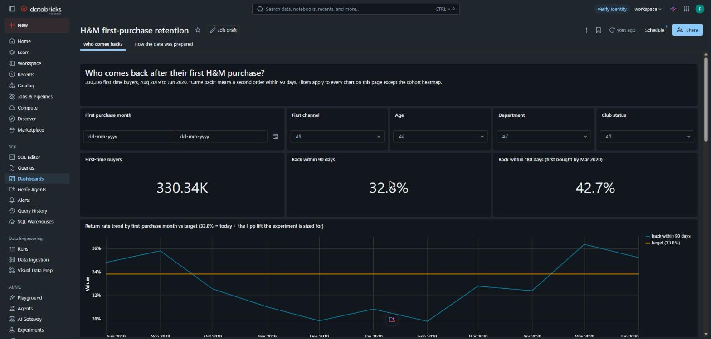
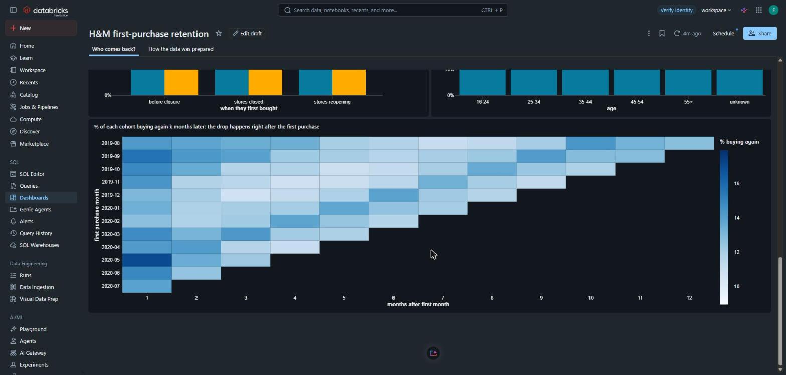
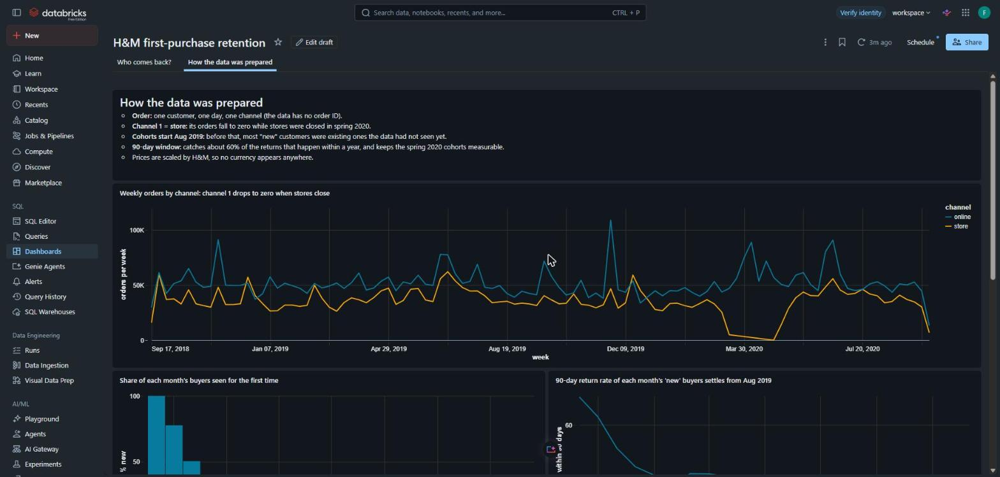
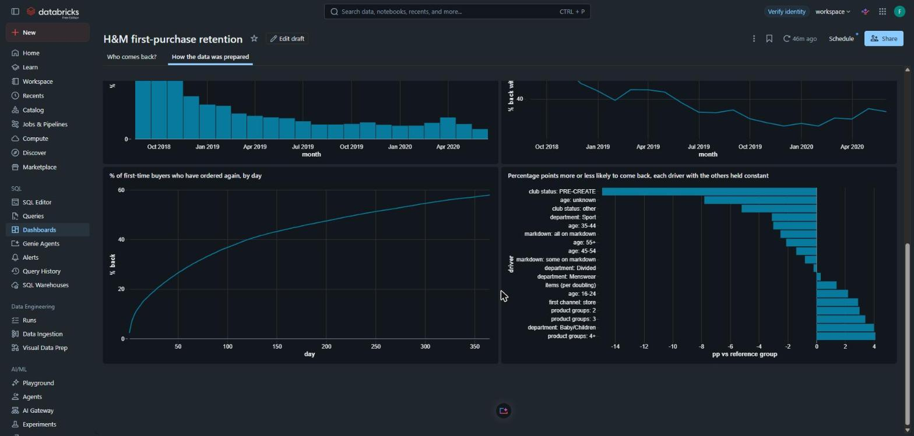

# What does a first purchase say about whether a customer comes back?

An analysis of H&M's real transaction data: 31.8M item purchases from 1.36M customers, September 2018 to September 2020. It looks at which first-time buyers return, what in their first purchase predicts it, and how to test whether pulling those levers actually works.

I picked this question because AI shopping products face the same problem. Glance's AI try-on shows a user one look, and the team has to work out which first sessions turn into people who come back. H&M's data is the closest public stand-in: a real fashion retailer at scale.

**Stack:** Databricks (Unity Catalog volume, Delta tables in bronze, silver and gold layers, Databricks SQL, a scheduled refresh job, AI/BI dashboard), plus Python (DuckDB, pandas, statsmodels) for the exploratory notebook, the regression and the experiment sizing.

## Dashboard (Databricks AI/BI)
Page 1 is the leadership view:
- the headline numbers
- the 90-day return rate for each month's new customers, tracked against a target
- the drivers

Every chart except the heatmap recalculates when you filter by first purchase month, channel, age, department or club status. The target, 33.8%, is today's 32.8% plus the 1-point lift the experiment below is sized to detect.

Page 2 shows the evidence behind each data decision, plus the driver effects in percentage points.

A Databricks job (`hm_retention_refresh`) rebuilds the silver tables, then the gold tables, every morning at 06:00 IST, so the dashboard always reads freshly built tables.

## Findings
Based on 330,336 first-time buyers between Aug 2019 and Jun 2020. The effects are average marginal effects from a logistic regression, so each one holds the other drivers (basket size, channel, department, markdown, age, club status, month) constant.

1. **Most customers are lost right after the first purchase.**
   - Only 32.8% come back within 90 days.
   - After the first two months, cohort retention barely moves: 9% to 14% of a cohort is active in any later month, out to month 12.
2. **An unfinished sign-up is the clearest warning sign.** Customers whose club membership was never completed (PRE-CREATE) are 14.9 pp less likely to come back (95% CI 14.4 to 15.5 pp).
3. **Breadth beats size.** A first basket covering 4 or more product groups makes a return 4.1 pp more likely than a single-group basket (95% CI 3.1 to 5.0 pp), on top of what basket size adds.
4. **Deal-only first purchases are weaker.** An all-markdown first basket makes a return 2.5 pp less likely than a full-price one.
5. **Pandemic online arrivals were not weaker customers.** First-time buyers who came in online while stores were closed returned 33.1% of the time, against 31.2% for online first-timers before the closures.
6. **The first product says a lot about the customer.** Among 46,958 one-item, full-price, online first orders, 30.2% of those who started with a dress came back within 90 days, against 19.0% for a bag, the lowest of 25 product types. Both rates are standardised to the same month and age mix (`first_product.py`, `exports/first_product.csv`). This is a correlation: the data cannot say whether the product changes the customer or different customers choose different products.

**How big is the breadth lever?** About 30,000 first-time buyers arrive each month, and 58.8% of them buy from a single category. If a "complete the look" suggestion turned 10% of those baskets into two-category baskets, and the full observational gap were causal, that would mean about 54 extra returning customers a month. That's an upper bound, which is why the next step is a test, not a launch.

**Limits**
- The first order explains only a small share of who comes back (pseudo R-squared 0.014), so these are levers, not predictions.
- Club status was recorded when the data was published, so part of that link may run the other way: customers who keep shopping may finish signing up later.
- The store advantage (2.9 pp overall) shrinks by more than half when the post-reopening summer of 2020 is excluded.

## Experiment
Everything above is correlation. This is the test I'd run before building anything around it.

- **Hypothesis:** showing first-time buyers a complementary second category at their first checkout raises the share who come back within 90 days. For Glance, that means a second-category suggestion right after the first try-on.
- **Randomization:** customers split 50/50 when they reach their first checkout, by a hash of the customer ID. Everyone in the test is then a first-time buyer, so the 32.8% baseline applies. Randomizing earlier would bias the result, because the suggestion could change who buys at all. A sample ratio mismatch check runs before results are read.
- **Analysis:** intent to treat. Everyone who reached checkout counts in their group, including anyone who abandons after seeing the suggestion.
- **Primary metric:** 90-day return rate. The baseline is 32.8%, and the minimum detectable effect is 1 percentage point.
- **Sample size:** 34,868 customers per arm (alpha 0.05, power 0.8). That's about 10 weeks of new customers, then 90 days before the result can be read. A 0.5-point bar would need about four times as many.
- **Leading indicator:** product groups in the first basket. It's readable the same day, so if it doesn't move within two weeks, the suggestion isn't changing behavior.
- **Guardrails:**
  - first-order value
  - markdown share, since deal-only first baskets return less
  - checkout completion, so the suggestion doesn't cost first orders
- **Decision rule:** ship if the 90-day lift's 95% confidence interval excludes zero and no guardrail is significantly worse. If the leading indicator moves but the return rate doesn't, the observational link wasn't causal, and the lever gets dropped.

## What it would mean for an AI try-on product
- **Treat onboarding completion as an activation metric.** For Glance, that's finishing the selfie step. Users who don't finish are the ones to worry about.
- **Test a second-category suggestion in the first session,** using the design above.
- **Test style-led first experiences against discount-led ones.** Judge them on return rate, not only first conversion.

## Decisions that shape the numbers
All are documented with evidence in [DECISIONS.md](DECISIONS.md).

| Decision | Why |
|---|---|
| An order is one customer, one day, one channel | The data has no order ID |
| Channel 1 = store, channel 2 = online | Channel 1 orders fall to zero from 23 March to the end of April 2020, while stores were closed |
| Cohorts start in August 2019 | The data starts mid-relationship. Before Aug 2019, most "new" customers were existing ones. Their 90-day return rate falls from 69.5% (Sep 2018) to a plateau of 30% to 36% |
| "Came back" = a second order within 90 days | 90 days catches 60.5% of the returns that happen within a year, and keeps the spring 2020 cohorts measurable. A 180-day check gives the same direction for every driver with a real effect |
| Prices are an index | H&M scaled all prices |

## Repository
| Path | What it is |
|---|---|
| `notebooks/analysis.ipynb` | Exploratory analysis, regression, impact sizing and experiment design, with every code cell explained line by line |
| `databricks/sql/01_bronze.sql` | Loads the raw files from the Unity Catalog volume into Delta tables |
| `databricks/sql/02_silver.sql` | Builds orders, first purchases and one row per first order with every driver |
| `databricks/sql/03_gold.sql` | Summary tables for the dashboard, with checks against the notebook |
| `databricks/job.py` | Creates the scheduled job that refreshes silver, then gold, every morning |
| `databricks/dashboard.py` | Builds and publishes the AI/BI dashboard through the Databricks dashboard API |
| `databricks/dashboard.lvdash.json` | The exported dashboard definition (import it in Databricks via Dashboards → Import) |
| `databricks/run.py`, `connect.py` | Upload the data and run the SQL through the Databricks SDK, signing in with browser OAuth |
| `DECISIONS.md` | Data quality log and the evidence behind each decision |
| `figures/` | Charts from the notebook |
| `exports/` | Result tables from the notebook. `marginal_effects.csv` feeds the dashboard's driver chart, and `experiment.csv` holds the experiment sizing |
| `first_product.py` | 90-day return rate by first product, adjusted for month and age |
| `load_data.py` | Downloads the three Kaggle files and converts them to Parquet |
| `requirements.txt` | Python dependencies |
| `LICENSE` | MIT license for the code |

## Reproduce
1. Install the dependencies: `pip install -r requirements.txt` (Python 3.12).
2. Download `transactions_train.csv`, `customers.csv` and `articles.csv` from the [Kaggle competition](https://www.kaggle.com/competitions/h-and-m-personalized-fashion-recommendations), after accepting its rules, and run `python load_data.py`.
3. Run the notebook to produce the local analysis and the exports.
4. For Databricks:
   - set the `DATABRICKS_HOST` environment variable to your workspace URL (sign-in happens in the browser, no token needed)
   - `python databricks/run.py upload`
   - `python databricks/run.py sql databricks/sql/01_bronze.sql`, then the same for `02_silver.sql` and `03_gold.sql`
   - `python databricks/job.py` to schedule the refresh, and `python databricks/dashboard.py` to publish the dashboard

**License:** the code is MIT licensed (see `LICENSE`). H&M released the dataset for non-commercial and academic use, and the data itself is not in this repository.
